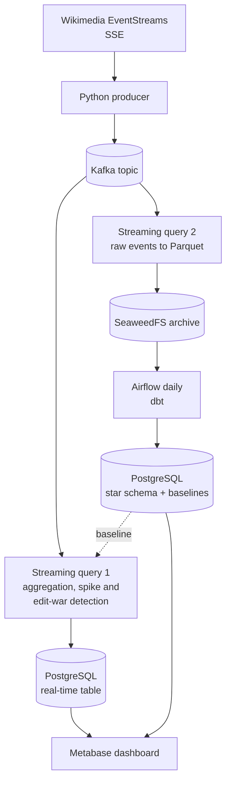
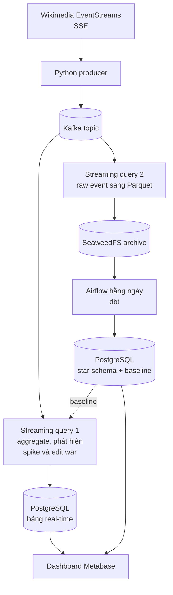

# WikiHeatmap

**English** | [Tiếng Việt](#tiếng-việt)

> 🚧 **Work in progress.** This README describes the goals and planned design. Nothing below is implemented yet.

Real-time heatmap of Wikipedia: detecting breaking events (edit spikes) and hidden content disputes (edit wars) with Kafka, Spark Structured Streaming, dbt and PostgreSQL.

## Why

Every edit to Wikipedia is published as a public event stream. Two signals hidden in that stream say a lot about what is happening in the world:

- **Attention**: a page suddenly gets far more edits than it usually does.
- **Contention**: several editors keep changing the same page back and forth.

WikiHeatmap combines both signals to classify activity on each page.

## The idea: two signals, four quadrants

|                          | Low contention | High contention     |
|--------------------------|----------------|---------------------|
| **High attention** (edit spike) | Breaking news  | Public controversy  |
| **Low attention**        | Normal         | **Hidden dispute**  |

The most interesting quadrant is **hidden dispute**: a page that few people are looking at, yet editors are fighting over its content.

### Signal definitions (draft)

- **Attention (edit spike):** the number of edits to a page in a time window, compared with that page's own historical baseline (for example, a z-score over a sliding window).
- **Contention (edit war):** on the same page, **at least two different editors edit alternately**, with the article size swinging back and forth or edit comments that indicate reverts. One person saving many times in a row does not count.
- **Cross-language comparison:** a page that is hot on one language edition but quiet on others suggests a local story.

Exact thresholds, windows and revert detection rules are still being decided.

## Planned architecture

- **Streaming and batch depend on each other:** the daily batch builds per-page baselines, and the streaming job compares live activity against them.
- **Two separate streaming queries**, each with its own checkpoint, so a failure in the aggregation job cannot cost the raw archive. The trade-off is that Kafka is read twice.
- **Planned star schema:** `fact_edits`, `dim_wiki`, `dim_editor`, plus per-page baseline tables.

## Goals

**Product**

1. Continuously ingest Wikimedia EventStreams into Kafka without losing events when the producer restarts.
2. Compute near real-time metrics based on **event time**.
3. Archive raw events as Parquet on SeaweedFS (S3-compatible object storage) for replay and historical analysis.
4. Build a daily star schema with dbt, including data quality tests and per-page baselines.
5. Provide a dashboard that combines real-time and historical views.

**Engineering**

- Handle event time, watermarks and late data in a real scenario (stopping and resuming the producer), with measured results.
- Make streaming and batch genuinely depend on each other.
- Make the system operable: checkpoints, idempotency, data quality tests, and the whole stack running with `docker compose up`.

**Out of scope**

- ML/NLP on article content.
- Production-grade deployment (Kubernetes, high availability). Everything runs locally in Docker, with no cloud services.

## Design principles

- **Detect signals, don't draw conclusions.** The system reports pages as *contested* or *anomalous*; it does not claim why.
- **Pages and topics, not people.** Analysis happens at the page/topic level. The project does not rank or profile individual editors. Editor names are kept as published by Wikimedia (anonymous edits appear as temporary accounts, not IP addresses), but the dashboard shows no editor rankings or profiles.
- **Bots are filtered out.** Mass bot edits create fake spikes, and anti-vandalism bots create fake edit wars.

## Tech stack

Python · Apache Kafka · Spark Structured Streaming (PySpark) · dbt · PostgreSQL · SeaweedFS · Airflow · Metabase · Docker Compose

The project uses only local services, so the whole stack starts with `docker compose up` at no cost. On a cloud platform, each storage and dashboard component can be replaced by a managed service:

| Role | This project (local) | Cloud alternative |
|---|---|---|
| Raw event archive | SeaweedFS (S3-compatible) | Google Cloud Storage, Amazon S3 |
| Data warehouse and real-time table | PostgreSQL | BigQuery, Snowflake, Amazon Redshift |
| Dashboard | Metabase | Looker Studio |

---

# Tiếng Việt

> 🚧 **Đang phát triển.** README này mô tả mục tiêu và thiết kế dự kiến. Chưa có phần nào bên dưới được hiện thực.

Bản đồ nhiệt real-time của Wikipedia: phát hiện sự kiện nóng (edit spike) và tranh chấp nội dung ngầm (edit war) bằng Kafka, Spark Structured Streaming, dbt và PostgreSQL.

## Vì sao

Mọi edit trên Wikipedia đều được phát ra thành một event stream công khai. Trong stream đó có hai tín hiệu cho biết khá nhiều về những gì đang diễn ra:

- **Attention (mức chú ý)**: một trang đột nhiên có nhiều edit hơn hẳn bình thường.
- **Contention (mức tranh chấp)**: nhiều editor liên tục sửa qua sửa lại cùng một trang.

WikiHeatmap kết hợp hai tín hiệu này để phân loại hoạt động của từng trang.

## Ý tưởng: hai tín hiệu, bốn ô

|                                 | Ít tranh chấp | Nhiều tranh chấp     |
|---------------------------------|---------------|----------------------|
| **Nhiều chú ý** (edit spike)    | Tin nóng      | Tranh cãi công khai  |
| **Ít chú ý**                    | Bình thường   | **Drama ngầm**       |

Ô đáng chú ý nhất là **Drama ngầm**: một trang ít người để ý, nhưng các editor lại đang giằng co về nội dung của nó.

### Định nghĩa tín hiệu (bản nháp)

- **Attention (edit spike):** số edit của một trang trong một time window, so với baseline lịch sử của chính trang đó (ví dụ z-score trên sliding window).
- **Contention (edit war):** trên cùng một trang, **ít nhất hai editor khác nhau sửa xen kẽ**, kích thước bài dao động qua lại hoặc comment của edit có dấu hiệu revert. Một người tự lưu nhiều lần liên tiếp thì không tính.
- **So sánh giữa các phiên bản ngôn ngữ:** một trang nóng ở một wiki nhưng yên ở các wiki khác là dấu hiệu của chuyện mang tính địa phương.

Ngưỡng, window và quy tắc nhận diện revert cụ thể vẫn đang được chốt.

## Kiến trúc dự kiến

- **Streaming và batch phụ thuộc nhau thật sự:** batch hằng ngày tạo baseline cho từng trang, streaming so sánh hoạt động trực tiếp với baseline đó.
- **Hai streaming query riêng**, mỗi query có checkpoint riêng, để job aggregate lỗi không làm mất raw archive. Trade-off là Kafka bị đọc hai lần.
- **Star schema dự kiến:** `fact_edits`, `dim_wiki`, `dim_editor`, cùng các bảng baseline theo trang.

## Mục tiêu

**Sản phẩm**

1. Ingest liên tục Wikimedia EventStreams vào Kafka, không mất event khi producer restart.
2. Tính metric gần real-time theo **event time**.
3. Lưu raw event thành Parquet trên SeaweedFS (object storage tương thích S3) để replay và phân tích lịch sử.
4. Hằng ngày build star schema bằng dbt, có data quality test và baseline cho từng trang.
5. Dashboard kết hợp góc nhìn real-time và lịch sử.

**Kỹ thuật**

- Xử lý event time, watermark và late data qua kịch bản thật (tắt producer rồi resume), có số liệu đo được.
- Streaming và batch phụ thuộc nhau thật sự.
- Hệ thống vận hành được: checkpoint, idempotency, data quality test, chạy toàn bộ bằng `docker compose up`.

**Ngoài phạm vi**

- ML/NLP trên nội dung bài viết.
- Deploy production-grade (Kubernetes, high availability). Mọi thứ chạy local bằng Docker, không dùng cloud service.

## Nguyên tắc thiết kế

- **Phát hiện tín hiệu, không đưa ra kết luận.** Hệ thống báo một trang là *contested* hoặc *anomalous*, không khẳng định nguyên nhân.
- **Trang và chủ đề, không phải con người.** Phân tích ở mức trang/chủ đề. Dự án không xếp hạng hay profile từng editor. Tên editor được giữ nguyên như Wikimedia công bố (edit ẩn danh hiện dưới dạng temporary account, không phải địa chỉ IP), nhưng dashboard không hiển thị xếp hạng hay hồ sơ editor.
- **Lọc bot.** Bot sửa hàng loạt tạo spike giả, bot chống vandalism tạo edit war giả.

## Công nghệ

Python · Apache Kafka · Spark Structured Streaming (PySpark) · dbt · PostgreSQL · SeaweedFS · Airflow · Metabase · Docker Compose

Dự án chỉ dùng các service chạy local, nên toàn bộ hệ thống khởi động bằng `docker compose up` mà không tốn chi phí. Nếu chạy trên cloud, có thể thay các thành phần lưu trữ và dashboard bằng managed service:

| Vai trò | Dự án này (local) | Thay thế trên cloud |
|---|---|---|
| Lưu trữ raw event | SeaweedFS (tương thích S3) | Google Cloud Storage, Amazon S3 |
| Data warehouse và bảng real-time | PostgreSQL | BigQuery, Snowflake, Amazon Redshift |
| Dashboard | Metabase | Looker Studio |
