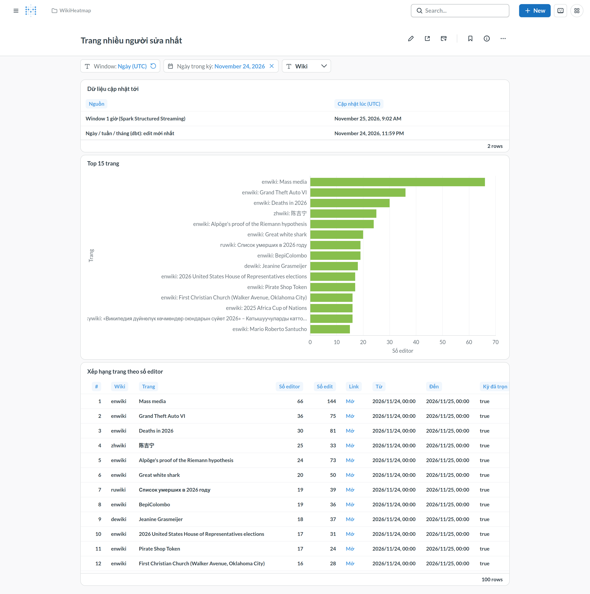
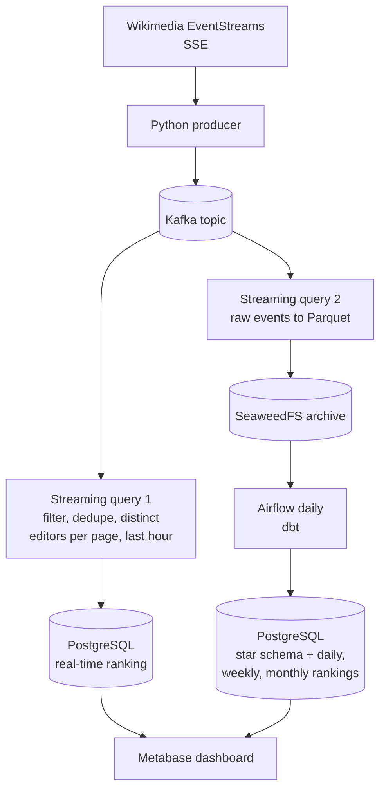
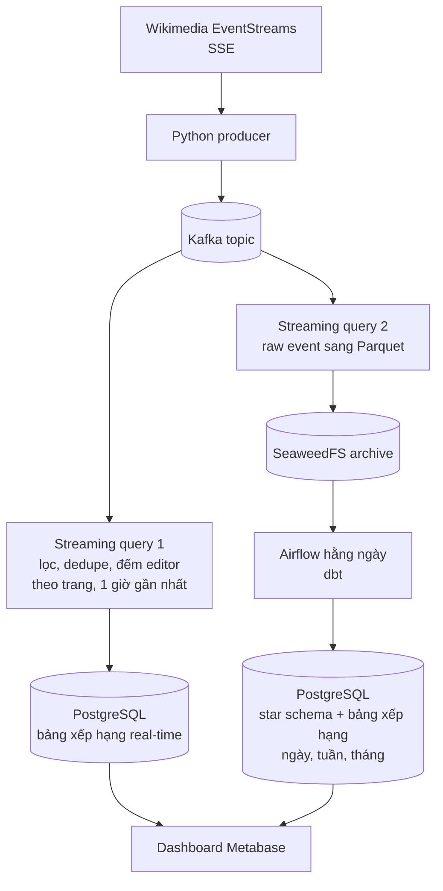

# WikiHeatmap

**English** | [Tiếng Việt](#tiếng-việt)

Real-time ranking of the Wikipedia pages with the most editors over the last hour, day, week and month, built with Kafka, Spark Structured Streaming, dbt and PostgreSQL.

*The Metabase dashboard (labels in Vietnamese): pages ranked by distinct editors for one day, all language editions. Filters choose the window (last hour, day, week, month), the period and the wiki.*

## Why

Every edit to Wikipedia is published as a public event stream. Counting how many different people are editing a page shows what the world is paying attention to right now: breaking news, a new release, an election.

## What it shows

Pages ranked by the **number of distinct editors**, highest first, for each language edition:

| Window | Updated | Computed by |
|---|---|---|
| Last hour | continuously | Spark Structured Streaming |
| Day, week, month | daily | dbt on PostgreSQL |

- **Distinct editors, not edits.** One person saving a page many times in a row is not a sign of interest; many different people editing it is. The number of edits is shown as a secondary column.
- **Human edits to articles only.** Bots, Wikidata, Commons and non-article namespaces are filtered out.

## Architecture

- **Streaming for the short window, batch for the long ones:** a one-hour window needs low latency and event-time handling; day, week and month windows tolerate a daily refresh and would be costly to keep in streaming state. Both use the same metric definition (filters, deduplication, distinct editors).
- **Distinct counts do not add up:** someone who edits a page on Monday and again on Tuesday is one editor for the week, so weekly and monthly rankings are computed from the edit-level fact table, not by summing daily rankings.
- **Two separate streaming queries**, each with its own checkpoint, so a failure in the aggregation job cannot cost the raw archive. The trade-off is that Kafka is read twice.
- **Star schema:** `fact_edits`, `dim_wiki`, `dim_editor`, plus per-page aggregate tables for each day, week and month.

## Late data, measured

The last-hour ranking uses a 1-hour window sliding every 5 minutes, a 30-second trigger and a 10-minute watermark. To choose the watermark, two real outages were replayed from Kafka through the same aggregation, cut into the same 30-second micro-batches by arrival time, once per watermark (`analysis/watermark_experiment.py`):

| Watermark | Edits dropped, producer off 10 min (24,553 edits) | Edits dropped, pipeline down 87 min (19,882 edits) | Peak state, 10 min off / 87 min down |
|---|---|---|---|
| 1 s | 2 | 4 | 70k / 97k rows |
| 10 s | 1 | 3 | 70k / 97k rows |
| 1 min | 0 | 0 | 71k / 98k rows |
| 5 min | 0 | 0 | 80k / 103k rows |
| 10 min | 0 | 0 | 91k / 109k rows |

- **Resuming after an outage loses almost nothing.** The producer resumes from its last event id and Wikimedia replays the backlog in order: events are late against the clock, not against each other.
- **Spark drops far less than a per-event estimate.** Measuring each edit's lateness on its own suggested that a 1-second watermark would drop about 20% of edits. Spark dropped 0.02% at most, because the watermark only moves between micro-batches: a late edit arriving in the same batch as newer ones is kept.
- **A longer watermark costs state, not speed or freshness.** Going from 1 second to 10 minutes adds about 30% state rows in normal operation, with the same batch time. In update mode the ranking refreshes every trigger whatever the watermark. After a long outage, the catch-up batch sets the peak state, not the watermark.
- **Kept: 10 minutes.** It drops nothing in either scenario, at a cost of 60–110 MB of state.

## Goals

**Product**

1. Continuously ingest Wikimedia EventStreams into Kafka without losing events when the producer restarts.
2. Compute the last-hour ranking in near real time, based on **event time**.
3. Archive raw events as Parquet on SeaweedFS (S3-compatible object storage) for replay and historical analysis.
4. Build a daily star schema with dbt, including data quality tests and per-page aggregates for each day, week and month.
5. Provide a dashboard ranking pages by distinct editors, with a choice of window (hour, day, week, month) and a filter by wiki.

**Engineering**

- Handle event time, watermarks and late data in a real scenario (stopping and resuming the producer), with measured results.
- Split the work cleanly between streaming (short window) and batch (long windows), with one shared metric definition.
- Make the system operable: checkpoints, idempotency, data quality tests, and the whole stack running with `docker compose up`.

**Out of scope**

- ML/NLP on article content.
- Interpreting activity: detecting edit wars or anomalies, comparing language editions.
- Production-grade deployment (Kubernetes, high availability). Everything runs locally in Docker, with no cloud services.

## Design principles

- **Count, don't interpret.** The dashboard shows how many people edit a page, not why.
- **Pages, not people.** Editor names are used only to count distinct editors per page. Names are kept as published by Wikimedia (anonymous edits appear as temporary accounts, not IP addresses), but the dashboard shows no editor names, rankings or profiles.

## Tech stack

Python · Apache Kafka · Spark Structured Streaming (PySpark) · dbt · PostgreSQL · SeaweedFS · Airflow · Metabase · Docker Compose

The project uses only local services, so the whole stack starts with `docker compose up` at no cost. On a cloud platform, each storage and dashboard component can be replaced by a managed service:

| Role | This project (local) | Cloud alternative |
|---|---|---|
| Raw event archive | SeaweedFS (S3-compatible) | Google Cloud Storage, Amazon S3 |
| Data warehouse and real-time table | PostgreSQL | BigQuery, Snowflake, Amazon Redshift |
| Dashboard | Metabase | Looker Studio |

---

# Tiếng Việt

Bảng xếp hạng real-time các trang Wikipedia có nhiều người chỉnh sửa nhất trong 1 giờ, ngày, tuần và tháng gần nhất, xây dựng bằng Kafka, Spark Structured Streaming, dbt và PostgreSQL.

*Dashboard Metabase: các trang xếp theo số editor khác nhau trong một ngày, mọi phiên bản ngôn ngữ. Bộ lọc chọn window (1 giờ gần nhất, ngày, tuần, tháng), kỳ và wiki.*

## Vì sao

Mọi edit trên Wikipedia đều được phát ra thành một event stream công khai. Đếm xem có bao nhiêu người khác nhau đang sửa một trang cho biết thế giới đang quan tâm tới điều gì: tin nóng, một bộ phim mới ra mắt, một cuộc bầu cử.

## Dashboard hiển thị gì

Các trang được xếp theo **số editor khác nhau**, giảm dần, cho từng phiên bản ngôn ngữ:

| Window | Cập nhật | Tính bằng |
|---|---|---|
| 1 giờ gần nhất | liên tục | Spark Structured Streaming |
| Ngày, tuần, tháng | hằng ngày | dbt trên PostgreSQL |

- **Đếm editor khác nhau, không đếm edit.** Một người lưu một trang nhiều lần liên tiếp không phải dấu hiệu được quan tâm; nhiều người khác nhau cùng sửa thì có. Số edit được hiển thị như cột phụ.
- **Chỉ tính edit của người trên bài viết.** Bot, Wikidata, Commons và các namespace không phải bài viết đều bị lọc ra.

## Kiến trúc

- **Streaming cho window ngắn, batch cho window dài:** window 1 giờ cần độ trễ thấp và xử lý event time; window ngày, tuần, tháng chấp nhận cập nhật hằng ngày, và giữ chúng trong state của streaming sẽ rất tốn bộ nhớ. Cả hai dùng chung một định nghĩa metric (quy tắc lọc, dedupe, đếm editor khác nhau).
- **Số editor khác nhau không cộng dồn được:** một người sửa trang vào thứ Hai rồi sửa tiếp vào thứ Ba chỉ là một editor của tuần, nên bảng tuần và tháng được tính lại từ fact table ở mức từng edit, không cộng từ bảng ngày.
- **Hai streaming query riêng**, mỗi query có checkpoint riêng, để job aggregate lỗi không làm mất raw archive. Trade-off là Kafka bị đọc hai lần.
- **Star schema:** `fact_edits`, `dim_wiki`, `dim_editor`, cùng các bảng tổng hợp theo trang cho từng ngày, tuần, tháng.

## Late data: số liệu đo được

Bảng xếp hạng 1 giờ dùng window 1 giờ trượt mỗi 5 phút, trigger 30 giây và watermark 10 phút. Để chọn watermark, hai lần dừng thật được replay từ Kafka qua đúng phép tổng hợp đó, chia thành đúng các micro-batch 30 giây theo thời điểm đến, mỗi watermark một lần (`analysis/watermark_experiment.py`):

| Watermark | Edit bị bỏ, tắt producer 10 phút (24.553 edit) | Edit bị bỏ, dừng pipeline 87 phút (19.882 edit) | State lớn nhất, tắt 10 phút / dừng 87 phút |
|---|---|---|---|
| 1 s | 2 | 4 | 70 nghìn / 97 nghìn dòng |
| 10 s | 1 | 3 | 70 nghìn / 97 nghìn dòng |
| 1 phút | 0 | 0 | 71 nghìn / 98 nghìn dòng |
| 5 phút | 0 | 0 | 80 nghìn / 103 nghìn dòng |
| 10 phút | 0 | 0 | 91 nghìn / 109 nghìn dòng |

- **Resume sau sự cố gần như không mất gì.** Producer resume từ event id cuối, Wikimedia phát lại backlog theo đúng thứ tự: event trễ so với giờ thật nhưng không trễ so với nhau.
- **Spark bỏ ít hơn nhiều so với ước lượng theo từng event.** Đo độ trễ của từng edit riêng lẻ thì watermark 1 giây tưởng như bỏ khoảng 20% edit. Spark chỉ bỏ nhiều nhất 0,02%, vì watermark chỉ tiến giữa các micro-batch: edit đến muộn nằm cùng batch với edit mới hơn vẫn được giữ.
- **Watermark dài tốn state, không làm chậm hay làm cũ kết quả.** Từ 1 giây lên 10 phút, state tăng khoảng 30% số dòng khi chạy bình thường, thời gian mỗi batch không đổi. Ở update mode bảng xếp hạng cập nhật sau mỗi trigger, bất kể watermark. Sau một đợt dừng dài, batch lấy bù quyết định đỉnh state, không phải watermark.
- **Giữ 10 phút.** Không bỏ edit nào ở cả hai kịch bản, đổi lại 60–110 MB state.

## Mục tiêu

**Sản phẩm**

1. Ingest liên tục Wikimedia EventStreams vào Kafka, không mất event khi producer restart.
2. Tính bảng xếp hạng 1 giờ gần real-time theo **event time**.
3. Lưu raw event thành Parquet trên SeaweedFS (object storage tương thích S3) để replay và phân tích lịch sử.
4. Hằng ngày build star schema bằng dbt, có data quality test và bảng tổng hợp theo trang cho từng ngày, tuần, tháng.
5. Dashboard xếp hạng trang theo số editor khác nhau, chọn window (giờ, ngày, tuần, tháng) và lọc theo wiki.

**Kỹ thuật**

- Xử lý event time, watermark và late data qua kịch bản thật (tắt producer rồi resume), có số liệu đo được.
- Chia việc rõ ràng giữa streaming (window ngắn) và batch (window dài), dùng chung một định nghĩa metric.
- Hệ thống vận hành được: checkpoint, idempotency, data quality test, chạy toàn bộ bằng `docker compose up`.

**Ngoài phạm vi**

- ML/NLP trên nội dung bài viết.
- Diễn giải hoạt động: phát hiện edit war hay bất thường, so sánh giữa các phiên bản ngôn ngữ.
- Deploy production-grade (Kubernetes, high availability). Mọi thứ chạy local bằng Docker, không dùng cloud service.

## Nguyên tắc thiết kế

- **Chỉ đếm, không diễn giải.** Dashboard cho biết bao nhiêu người sửa một trang, không giải thích vì sao.
- **Trang, không phải con người.** Tên editor chỉ dùng để đếm số editor khác nhau của mỗi trang. Tên được giữ nguyên như Wikimedia công bố (edit ẩn danh hiện dưới dạng temporary account, không phải địa chỉ IP), nhưng dashboard không hiển thị tên, xếp hạng hay hồ sơ editor.

## Công nghệ

Python · Apache Kafka · Spark Structured Streaming (PySpark) · dbt · PostgreSQL · SeaweedFS · Airflow · Metabase · Docker Compose

Dự án chỉ dùng các service chạy local, nên toàn bộ hệ thống khởi động bằng `docker compose up` mà không tốn chi phí. Nếu chạy trên cloud, có thể thay các thành phần lưu trữ và dashboard bằng managed service:

| Vai trò | Dự án này (local) | Thay thế trên cloud |
|---|---|---|
| Lưu trữ raw event | SeaweedFS (tương thích S3) | Google Cloud Storage, Amazon S3 |
| Data warehouse và bảng real-time | PostgreSQL | BigQuery, Snowflake, Amazon Redshift |
| Dashboard | Metabase | Looker Studio |
